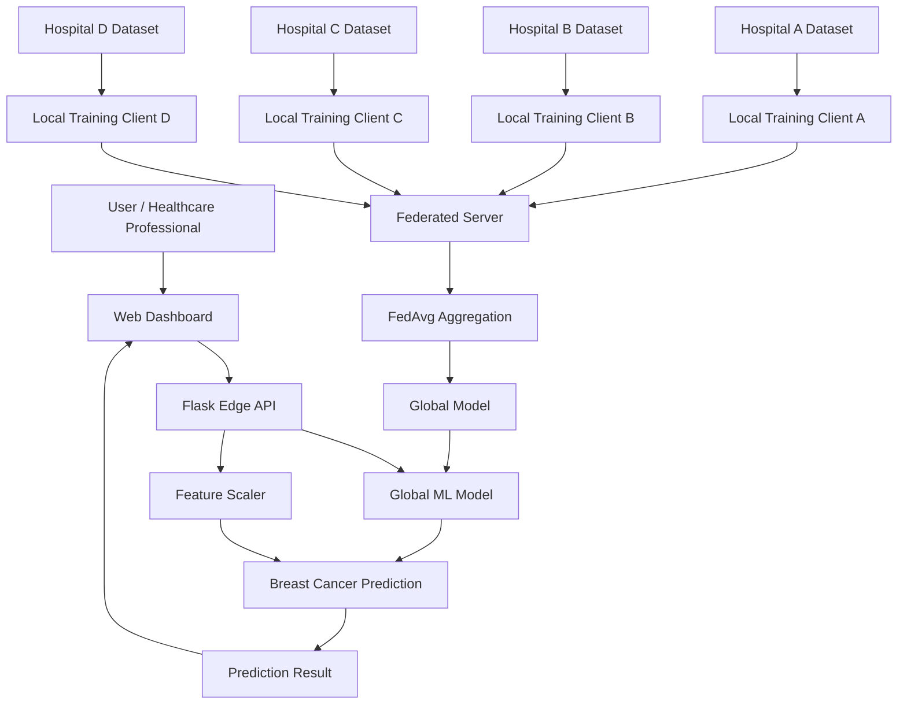
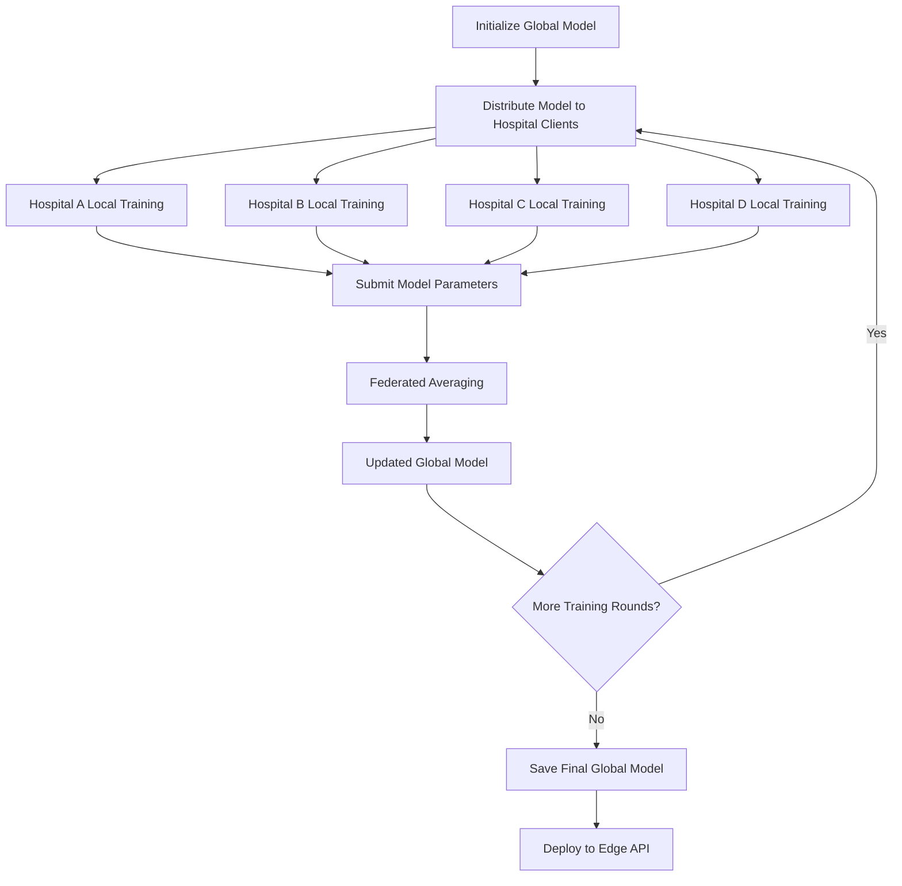
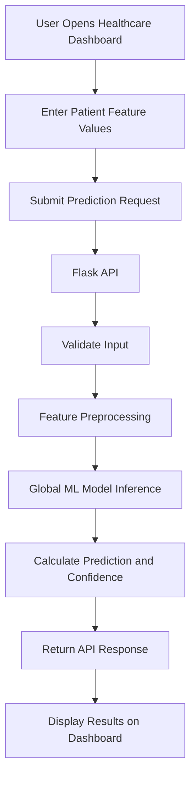

# BRCA-Federated-Edge-Healthcare
Privacy-preserving breast cancer prediction using Federated Learning and Edge Computing


## Overview

Federated Learning and Edge Computing for Privacy-Preserving Breast Cancer Prediction is an AI-powered healthcare project that combines distributed machine learning, federated learning, and edge computing to support breast cancer prediction while reducing the need to centralize sensitive medical data.

The system simulates multiple hospitals participating in collaborative machine learning. Each hospital trains a model using its locally stored data. Instead of sharing raw patient records, the participating hospitals share model parameters with a federated server, where updates are aggregated into a global model using Federated Averaging (FedAvg).

The trained global model is deployed to an edge environment through a Flask-based API, enabling predictions through a web interface.

The project demonstrates how distributed machine learning can be integrated with web technologies to build a privacy-aware healthcare AI architecture.


## Key Features

- Federated learning simulation with four hospital clients.
- Distributed model training using local hospital datasets.
- Federated model aggregation using the FedAvg algorithm.
- Privacy-oriented data architecture that avoids centralized raw-data collection during federated training.
- Edge deployment of the trained global model.
- Flask REST API for model inference.
- Breast cancer classification using the Wisconsin Diagnostic Breast Cancer (WDBC) dataset.
- Interactive web-based dashboard.
- Real-time inference from user-provided feature values.
- Model and preprocessing artifact management.
- Hospital-client simulation and federated training workflow.


## System Architecture

### High-Level Architecture


### Federated Learning Workflow




## Technology Stack

 Category | Technologies 
 Programming Language | Python 
 Machine Learning | Scikit-learn 
 Federated Learning | Flower (FL Framework) 
 Federated Aggregation | FedAvg 
 Data Processing | Pandas, NumPy 
 Model Preprocessing | Scikit-learn StandardScaler 
 Backend | Flask 
 API | REST API 
 Frontend | React, Vite, JavaScript 
 UI Styling | HTML, CSS 
 Model Serialization | Pickle 
 Dataset | Wisconsin Diagnostic Breast Cancer (WDBC) 
 Development Tools | PyCharm, VS Code 
 Version Control | Git, GitHub 


## Machine Learning Dataset

### Wisconsin Diagnostic Breast Cancer (WDBC)

This project uses the Wisconsin Diagnostic Breast Cancer dataset, which contains features extracted from breast mass digitized images.

The dataset contains numerical measurements associated with cell nuclei characteristics.

### Dataset Characteristics

 Attribute | Description 
 Dataset | Wisconsin Diagnostic Breast Cancer (WDBC) 
 Classification | Binary classification 
 Target classes | Benign (B), Malignant (M) 
 Input features | 30 numerical features 
 Feature groups | Mean, standard error, and worst measurements 
 Learning task | Breast cancer classification 

### Input Features

The model uses numerical features such as:

- Radius
- Texture
- Perimeter
- Area
- Smoothness
- Compactness
- Concavity
- Concave points
- Symmetry
- Fractal dimension

These measurements are provided in mean, standard error, and worst-value forms.


## Federated Learning Methodology

Federated learning enables multiple clients to collaboratively train a shared model without directly combining their raw datasets into one centralized training dataset.

### Participating Hospitals

The system simulates four independent healthcare institutions.

 Client | Role 
 Hospital A | Local data training and model update 
 Hospital B | Local data training and model update 
 Hospital C | Local data training and model update 
 Hospital D | Local data training and model update 

Each hospital maintains its own local dataset and performs local training.

### Training Process

1. Initialize the global machine learning model.
2. Distribute the global model to participating hospital clients.
3. Each hospital trains the model using its own local dataset.
4. Hospitals return model parameters or updates to the federated server.
5. The server aggregates the received updates.
6. The aggregated model becomes the new global model.
7. The process repeats across multiple federated rounds.
8. Save the final global model for edge deployment.

### Federated Averaging (FedAvg)

FedAvg combines model parameters from multiple clients using a weighted average based on the number of training samples at each client.

Mathematically:

\[
w_{global}=\sum_{k=1}^{K}\frac{n_k}{N}w_k
\]

Where:

- \(w_{global}\) = aggregated global model parameters
- \(w_k\) = parameters from client \(k\)
- \(n_k\) = number of local training samples at client \(k\)
- \(N\) = total number of training samples across participating clients
- \(K\) = total number of participating clients

### FedAvg Code Example

The following illustrates the parameter-aggregation principle.

```python
import numpy as np

def federated_averaging(client_weights, client_sizes):
    total_samples = sum(client_sizes)

    averaged_weights = []

    for layer_index in range(len(client_weights[0])):
        layer_average = np.zeros_like(
            client_weights[0][layer_index]
        )

        for client_index in range(len(client_weights)):
            weight = client_sizes[client_index] / total_samples

            layer_average += (
                weight * client_weights[client_index][layer_index]
            )

        averaged_weights.append(layer_average)

    return averaged_weights
```

This is an illustrative aggregation function. The project's actual aggregation process is handled through its federated learning framework.


## Edge Computing Architecture

Edge computing enables machine learning inference to be performed close to the application or user instead of depending on a centralized cloud prediction service for every request.

### Edge Deployment Workflow

1. Train the global model through federated learning.
2. Export the final global model.
3. Save the preprocessing scaler.
4. Load the model and scaler in the edge environment.
5. Start the Flask API.
6. Receive input features from the web application.
7. Preprocess the input.
8. Run model inference.
9. Return the prediction and confidence score.

### Edge Components

 Component | Responsibility 
 Flask API | Receives prediction requests 
 Global Model | Performs breast cancer classification 
 Scaler | Standardizes the input features 
 Edge Device | Hosts inference services 
 Frontend | Displays predictions and analytics 


## Model Prediction Workflow



### Prediction Categories

The classification model produces one of two categories:

 Class | Meaning 
 Benign | Classified as benign by the model 
 Malignant | Classified as malignant by the model 

The output represents a machine learning prediction and is not a medical diagnosis.


## Backend API

The Flask backend provides an interface between the web dashboard and the deployed machine learning model.

### Health Endpoint

Endpoint

```http
GET /api/health
```

Purpose

Checks the API status and verifies whether the model and scaler are loaded.

Example Response

```json
{
  "status": "online",
  "model_loaded": true,
  "scaler_loaded": true
}
```

### Prediction Endpoint

The prediction endpoint accepts feature values and returns the model classification.

Example request structure:

```http
POST /api/predict
Content-Type: application/json
```

Illustrative request body:

```json
{
  "features": [
    17.99,
    10.38,
    122.8,
    1001.0,
    0.1184,
    0.2776,
    0.3001,
    0.1471,
    0.2419,
    0.07871
  ]
}
```

The actual endpoint path and expected feature schema must match the backend implementation. The WDBC model requires the complete set of 30 features in the correct training order.

Illustrative response:

```json
{
  "prediction": "Malignant",
  "confidence": 96.5
}
```

## Installation and Setup

### Prerequisites

- Python 3.10+
- Node.js and npm
- Git
- PyCharm or Visual Studio Code

### 1. Clone the Repository

```bash
git clone https://github.com/YOUR-USERNAME/BRCA-Federated-Edge-Healthcare.git
```

Navigate to the project directory:

```bash
cd BRCA-Federated-Edge-Healthcare
```

### 2. Create a Python Virtual Environment

Windows:

```powershell
python -m venv .venv
```

Activate the environment:

```powershell
.venv\Scripts\activate
```

### 3. Install Python Dependencies

```bash
pip install -r requirements.txt
```

If the requirements file is not available:

```bash
pip install flask numpy pandas scikit-learn flwr
```

### 4. Prepare Hospital Datasets

Run the dataset-splitting script if the hospital datasets have not already been generated:

```bash
python split_hospitals.py
```

This script prepares the local datasets for the hospital clients. Review the script before running it to ensure the output paths match your environment.

---

## Running the Federated Learning System

The federated learning workflow consists of a server and multiple participating clients.

### Step 1: Start the Federated Server

Open a terminal in the project directory:

```bash
python federated_server/server.py
```

The server coordinates the federated training rounds and aggregates client updates.

### Step 2: Start Hospital Clients

Run the client scripts for the participating hospitals in separate terminals, following the configuration in your project.

Example:

```bash
python hospitals/hospital_A/edge/edge_A.py
```

```bash
python hospitals/hospital_B/edge/edge_B.py
```

```bash
python hospitals/hospital_C/edge/edge_C.py
```

```bash
python hospitals/hospital_D/edge/edge_D.py
```

If your project uses `federated_client.py` as the common client launcher, use the launch commands configured in that file instead.

### Step 3: Federated Training

The federated server coordinates training across the hospital clients.

Configured training parameters in this project include:

 Parameter | Value 
 Number of clients | 4 
 Federated algorithm | FedAvg 
 Training rounds | 10 
 Fit participation | 100% 
 Evaluation participation | 100% 

The final global model is saved for deployment in the edge prediction environment.


## Security and Privacy Considerations

This project demonstrates a privacy-oriented distributed learning architecture.

### Privacy Design

- Hospital datasets are partitioned into local client datasets.
- Local training is performed on individual hospital clients.
- Raw training data is not intentionally sent to the federated server during model aggregation.
- The federated server receives model updates for aggregation.
- The global model is deployed for inference.

### Security Limitations

Federated learning alone does not guarantee complete privacy. Model updates can potentially reveal information, and this prototype does not claim to implement formal privacy guarantees such as differential privacy or cryptographic secure aggregation unless these mechanisms are separately implemented and tested.

The system is an academic prototype and is not approved for clinical diagnosis or real patient treatment decisions.


## Performance Evaluation

The project can be evaluated using standard classification metrics.

| Metric | Description |
|---|---|
| Accuracy | Overall percentage of correctly classified observations |
| Precision | Proportion of predicted positives that are correct |
| Recall | Proportion of actual positives correctly identified |
| F1-Score | Harmonic mean of precision and recall |
| Confusion Matrix | Summary of correct and incorrect classifications |

For healthcare classification, recall and false-negative analysis are particularly important. A high overall accuracy alone is insufficient to assess the clinical suitability of a model.


## Future Enhancements

- Secure aggregation for federated model updates.
- Differential privacy mechanisms.
- Authentication and role-based access control.
- Encrypted communication between clients and server.
- Model drift monitoring.
- Improved explainability with SHAP.
- More realistic non-IID hospital datasets.
- Real-time monitoring of client participation.
- Deployment using Docker.
- Cloud and edge-device deployment.
- Audit logging and model version tracking.
- Robust validation and testing pipeline.


## Limitations

- The hospital clients are simulated using partitioned datasets.
- Dataset performance may not generalize to real clinical populations.
- The project is not integrated with live hospital systems.
- Federated communication is demonstrated in a development environment.
- Model performance is dependent on the dataset, feature preprocessing, and training configuration.
- This system is for educational and research purposes only.

